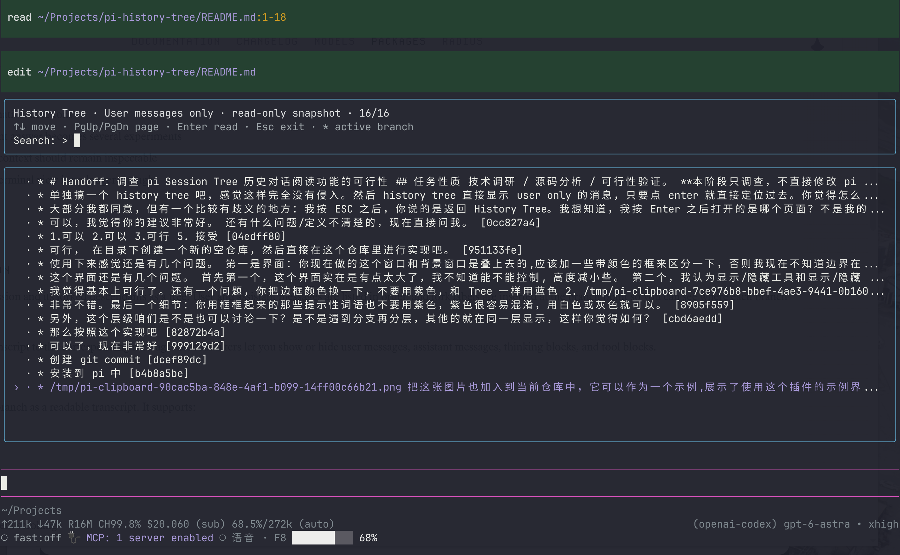

# pi-history-tree

一个用于 pi 的只读历史浏览器，让你专注回看自己的输入和模型的最终回复，无需切换分支或改变当前会话。



[English](README.md) · 简体中文

## 和 pi 自带的 Tree 有什么区别？

pi 自带的 `/tree` 用于定位会话历史、切换分支；**`/history-tree` 专注于阅读历史对话。**

- **更简洁：**树中只列出用户消息；阅读器默认只显示用户输入和最终回复，隐藏 Thinking、工具调用和中间过程。
- **只阅读，不跳转会话：**按 Enter 在独立阅读器中打开选中的消息，不改变当前会话位置、不创建分支，也不发送模型请求。
- **保留分支关系：**连续消息保持同层，只有分叉才增加缩进。每次只阅读一条分支，不混入其它分支的消息。
- **保留浏览位置：**Esc 返回历史树，保留搜索词和选择；再按 Esc 回到原本的对话。
- **需要时查看细节：**Ctrl+P 切换到完整过程，查看工具、Thinking 和压缩摘要等已保存内容。

这是一个独立扩展，不修改 pi 核心，也不替换原生 `/tree`。

## 安装

需要先安装 pi。已在 `@earendil-works/pi-coding-agent` **1.4.0** 上验证。

### 从 npm 安装

`0.1.0` 发布到 npm 后，可执行：

```bash
pi install npm:pi-history-tree
```

也可以固定安装版本：

```bash
pi install npm:pi-history-tree@0.1.0
```

已经运行的 pi 执行 `/reload` 即可加载；以后启动 pi 会自动加载。

### 从本地仓库安装

克隆或下载本仓库后，**在仓库目录内**执行：

```bash
pi install .
```

这会将本地包注册到当前用户的 pi 配置中。请保留仓库目录，pi 会直接从这个目录加载插件。

已经运行的 pi 执行 `/reload` 即可加载；以后启动 pi 会自动加载。

### 不安装，临时体验

npm 发布后：

```bash
pi -e npm:pi-history-tree
```

也可以临时加载本地仓库：

```bash
pi -e /absolute/path/to/pi-history-tree/src/index.js
```

将路径替换为实际仓库路径。两种方式都只对本次启动生效，不修改配置。

如果之前安装了本地版本，切换到 npm 时先移除本地注册，避免重复加载：

```bash
pi remove /absolute/path/to/pi-history-tree
pi install npm:pi-history-tree
```

这只会移除 pi 中的注册，不会删除仓库目录。

## 使用

在 pi 中输入：

```text
/history-tree
```

1. 直接输入文字搜索历史消息，用 **↑ / ↓** 选择。
2. 按 **Enter** 打开阅读器，自动定位到选中的消息。
3. 用 **↑ / ↓** 滚动，或用 **PgUp / PgDn** 翻页。
4. 按 **Esc** 返回历史树，再按 **Esc** 退出浏览器。

选中的消息属于当前分支时，直接打开当前分支；否则，如果存在多个后续分支，会先让你选择要阅读哪一条。`*` 标记当前分支上的消息。

### 快捷键

**历史树**
- 直接输入搜索，Backspace 编辑搜索词；也支持搜索消息 ID。
- ↑ / ↓ 移动选择，PgUp / PgDn 翻页。
- Enter 打开阅读器；Esc 直接退出，即使搜索框中有文字。

**阅读器**
- ↑ / ↓ 滚动，PgUp / PgDn 翻页，Home / End 跳到开头或结尾。
- Ctrl+P 切换“**用户输入＋最终回复**”和“**完整过程**”。
- Esc 返回历史树。

## 说明

- “最终回复”根据历史记录的结束状态判断，不调用模型生成摘要。未完成或无法确认的回复会显示简短提示，可用 Ctrl+P 查看原始过程。
- 图片显示为占位提示。工具输出以实际保存的内容为准，无法恢复保存前已被截断的内容。
- 阅读器展示打开时的快照。如果模型仍在运行，它会继续正常工作；关闭浏览器后重新打开即可看到更新的消息。

## 许可证

本项目采用 [MIT 许可证](LICENSE)，版权归 2026 JXZxiao5 所有。
